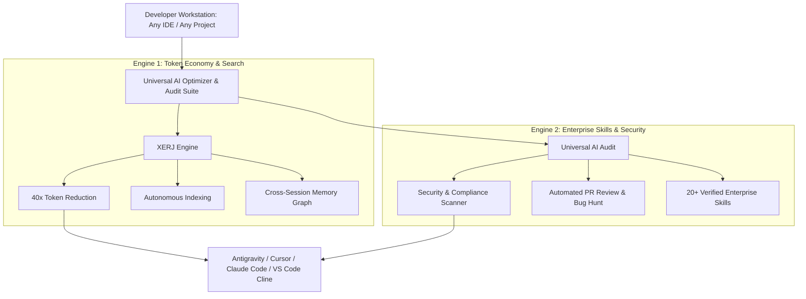

# 🚀 Universal AI Optimizer & Audit Suite

[](https://opensource.org/licenses/MIT)
[](https://microsoft.com/windows)
[](https://github.com/xerj-org/xerj)
[](https://github.com/taimazus/universal-ai-audit)
[](#)

> **The Ultimate All-in-One AI Workstation Engine for Developers & Teams.**  
> Combines **[XERJ Engine](https://github.com/xerj-org/xerj)** (40x token reduction, auto-indexing, semantic search) with **[Universal AI Audit](https://github.com/taimazus/universal-ai-audit)** (20+ enterprise agent skills, automated security scanning, code health audits).

[📖 مطالعه راهنمای جامع فارسی (Persian Documentation)](README.fa.md)

---

## ⚡ What Does This Suite Include?



### 1. XERJ Search & Token Optimizer
- **40x Token Reduction:** Deprecates brute-force grep and AST dumps.
- **Cross-Session Memory Graph:** Retains developer architectural choices and decisions across all chats.
- **Self-Healing Index:** Silently verifies and updates `.xerj` index on any repository.

### 2. Universal AI Audit Integration
- **20+ Enterprise Skills:** Equips agents with `enterprise-audit`, `security-audit`, `pr-review`, `test-gap-analysis`, `audit-fix-loop`, and more.
- **Standards & Health Checks:** Automatically inspects repositories for vulnerabilities and silent failures.

---

## 🛠️ 1-Click Universal Installation

Open **PowerShell (Administrator)** on any Windows machine and execute:

```powershell
irm https://raw.githubusercontent.com/taimazus/universal-ai-optimizer/main/setup-ai-optimizer.ps1 | iex
```

### Optional Flags:
- Install Optimizer only: `.\setup-ai-optimizer.ps1 -SkipAudit`
- Install Audit only: `.\setup-ai-optimizer.ps1 -SkipOptimizer`

---

## 🧩 Supported AI Environments

- **Google Antigravity IDE**
- **Cursor IDE**
- **Claude Code & Claude Desktop**
- **VS Code (Cline / Roo Code / Continue)**

---

## 👤 Author & Ecosystem

Developed and Maintained by **[Taimazus](https://github.com/taimazus)**  
- Suite Repo: [universal-ai-optimizer](https://github.com/taimazus/universal-ai-optimizer)
- Auditor Repo: [universal-ai-audit](https://github.com/taimazus/universal-ai-audit)
