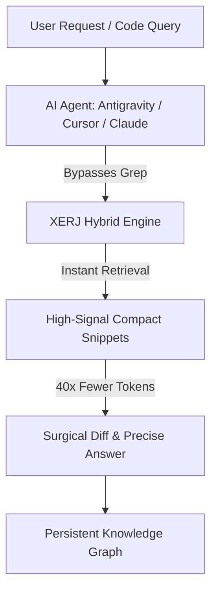

# 🚀 Universal AI Optimizer

[](https://opensource.org/licenses/MIT)
[](https://microsoft.com/windows)
[](https://github.com/xerj-org/xerj)
[](#)

> **Autonomous system-wide AI optimization for Antigravity, Cursor, VS Code, and Claude Code.**  
> Equips all AI coding agents across all workspaces with ultra-fast semantic search, cross-session memory, and 40x token reduction.

[📖 مطالعه راهنمای فارسی (Persian Documentation)](README.fa.md)

---

## ⚡ Why Universal AI Optimizer?

Traditional AI agents rely on brute-force `grep` or dump thousands of file lines into the chat context, exhausting token limits and causing the model to hallucinate.

This suite injects a **Global Constitution** and connects **XERJ Engine** across all IDEs so every agent instinctively knows what to do without prompt reminders.



### 📊 Performance Comparison

| Metric | Traditional Agents (Grep/AST) | With Universal AI Optimizer |
| :--- | :--- | :--- |
| **Search Method** | Linear Regex File Scan | Compact Semantic + Keyword Index |
| **Token Burn per Query** | ~15,000 – 40,000 tokens | **< 800 tokens (40x reduction)** |
| **Agent Behavior** | Verbose fluff & full-file rewrites | Surgical Diffs & Action-first |
| **Cross-Chat Memory** | ❌ Forgotten after chat closes | ✅ Persistent Graph Across Sessions |
| **Legacy Codebase Support**| Manual configuration | Autonomous Self-Healing Index |

---

## 🛠️ 1-Click Installation

Open **PowerShell (Administrator)** and run:

```powershell
irm https://raw.githubusercontent.com/taimazus/universal-ai-optimizer/main/setup-ai-optimizer.ps1 | iex
```

---

## 🧩 Supported Environments

- **Google Antigravity IDE** (Full MCP & Constitution Rules)
- **Cursor IDE** (Global Rules `.cursorrules` & MCP)
- **Claude Code & Claude Desktop** (`CLAUDE.md` & Config)
- **VS Code (Cline / Roo Code / Continue)**

---

## 👤 Author

Developed & Maintained by **[Taimazus](https://github.com/taimazus)**  
*Crafted for autonomous developer workstations.*
